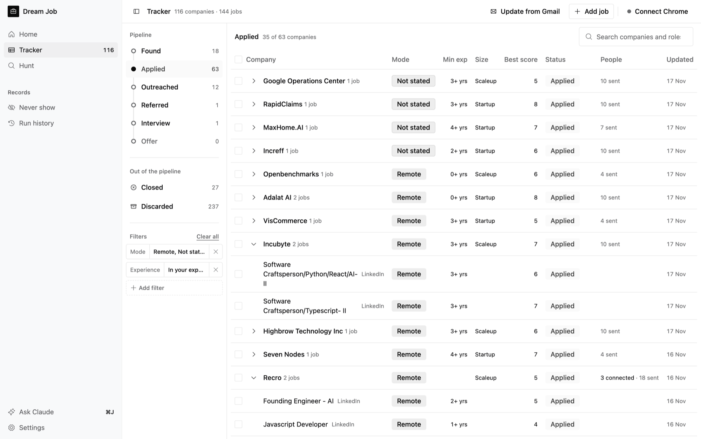
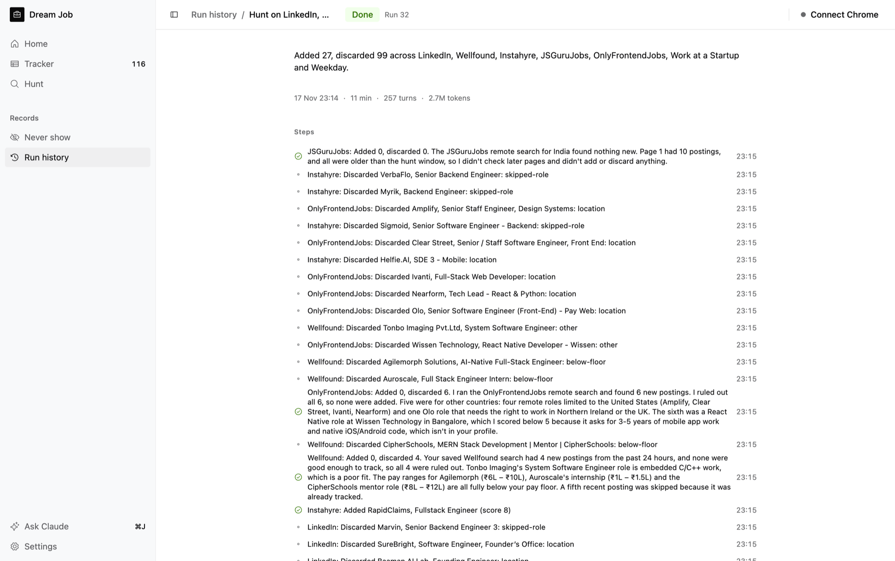
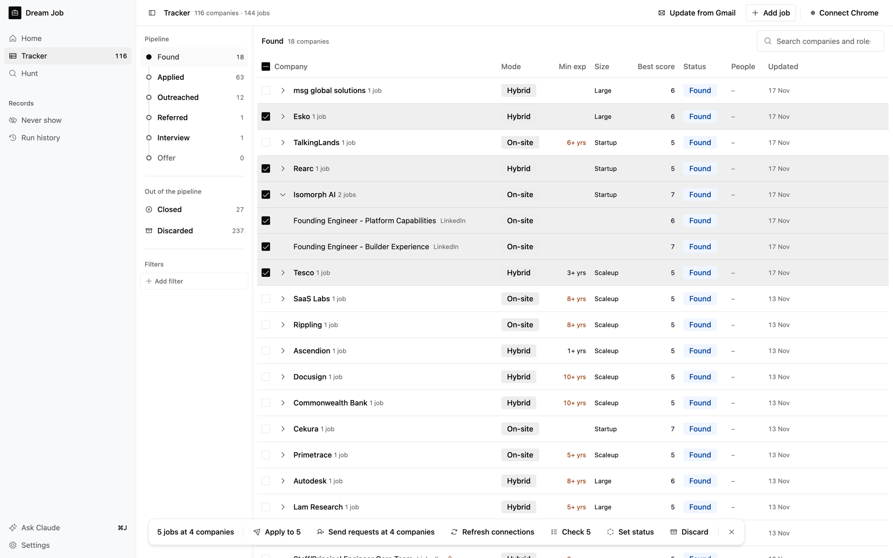
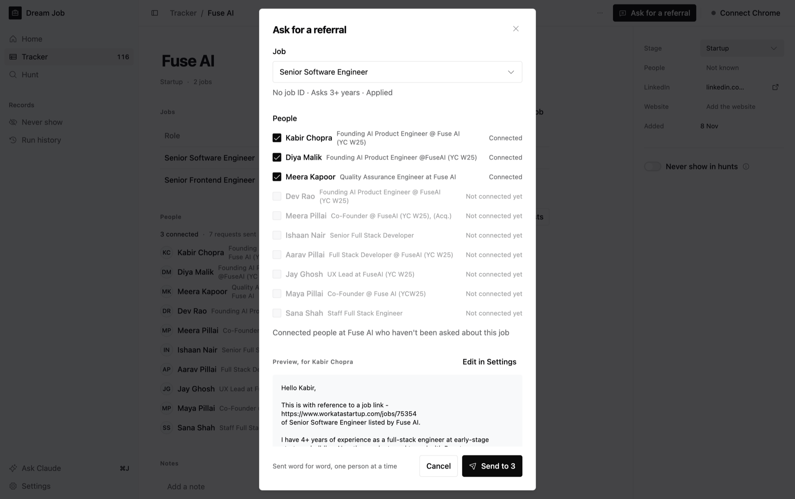
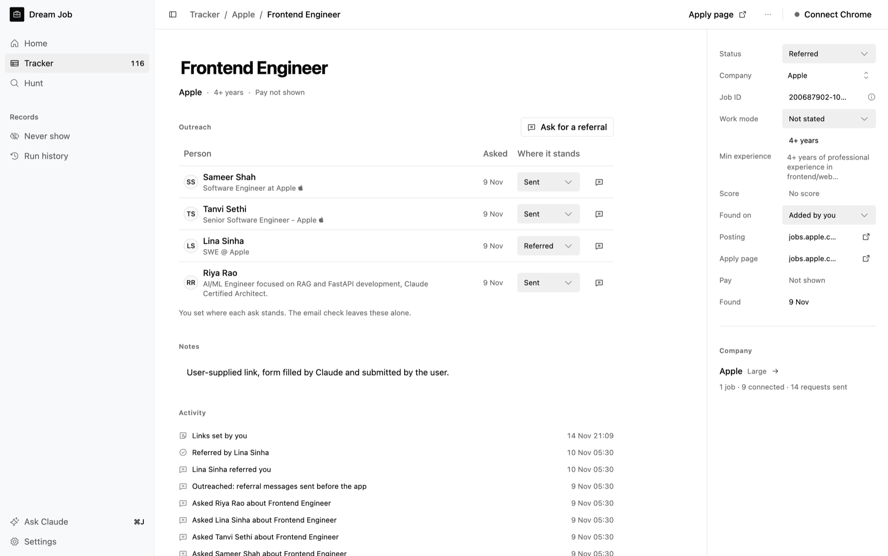
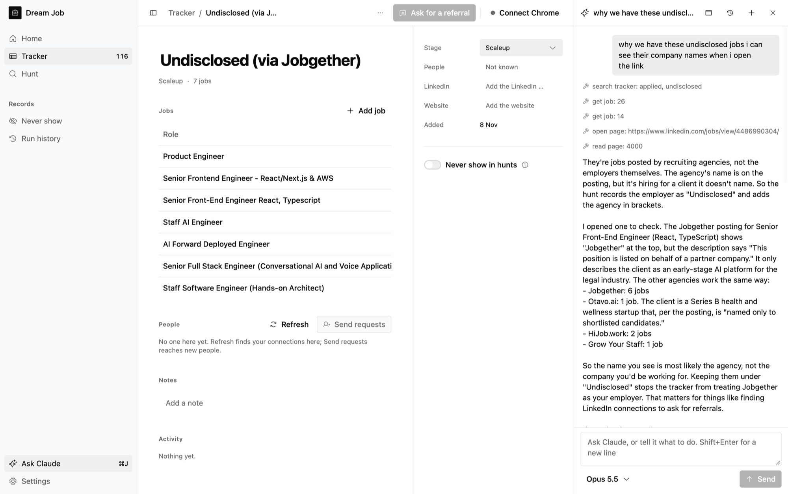

<div align="center">


# Find. Apply. Get referred.

**Dream Job** finds jobs on seven job boards, applies to them, builds a referral path at each company, and keeps your tracker current from your Gmail. All with your own Claude Code, in your own Chrome.

[](LICENSE)
[](#get-started)
[](https://claude.com/claude-code)
[](https://github.com/INNOVATIVEGAMER/dream-job/issues)

[Get started](#get-started) · [Job boards](#job-boards) · [The risks](#read-this-first-the-risks) · [Your data](#your-data) · [Contributing](CONTRIBUTING.md)

</div>

<br>



## Get started

There's no download yet, so build it once:

```bash
git clone https://github.com/INNOVATIVEGAMER/dream-job.git
cd dream-job
pnpm install
node node_modules/electron/install.js
pnpm dist:mac:local
```

Drag **Dream Job** from `release/mac-arm64` (Apple silicon) or `release/mac` (Intel) into Applications, and open it. Setup takes a few minutes: it checks Claude Code, reads your resume, asks what you're looking for, and has you sign in to each board in the app's own Chrome.

You need macOS 12 or later with Google Chrome, Claude Code signed in with `claude auth login` (a Claude plan or an API key), Node.js 22 or later with pnpm, and your resume as a PDF.

## Seven boards. One hunt.

Tell it the roles you want. It searches, reads every posting, and keeps what fits.



Each posting is scored 1 to 10 against your profile. The years a job asks come from the posting's own words, and anything ruled out lands in Discarded with the line that ruled it out. **[See the boards →](#job-boards)**

## Pick the jobs. It applies.

Up to 5 at a time, from your resume and your saved answers.



Easy Apply, the boards' own forms, and company career sites. Anything written in your voice waits for you before it goes.

## A referral path at every company.

It finds who you know, connects with who you don't, then asks in your own words.



Blank connection requests to up to 10 new people per company, never with a note. Once they accept, your saved referral message goes word for word to the people you pick. No ask goes out for a job more than a year past your experience, or where a recruiting firm doesn't name who is hiring.

## Your tracker, kept current.

A pipeline from Found to Offer, moved on by your Gmail.



The email check reads your newest emails and moves jobs on: rejections, interviews, offers and replies. Check postings marks the ones that closed. Every ask, referral and status change is a line in the job's history. Filter by mode, size, job board, experience, and whether the employer is named.

## Claude beside every screen.

Ask about your search, or have it do the work.



Cmd J opens a chat on any screen. It reads your tracker, changes statuses and notes, starts runs, and works in Chrome in a tab of its own. Anything that sends waits on a card for you. Pick the model in Settings.

## You stay in charge.

- Anything written in your voice waits for your approval before it is sent.
- Passwords, one-time codes, CAPTCHAs, payment details and IDs: the run stops and hands Chrome to you.
- Claude never writes to anyone beyond your saved referral message.

## Read this first: the risks

- **LinkedIn and most job boards don't allow automation** in their terms. Using Dream Job breaks them, and they can restrict or close accounts. Bulk connection requests are the most watched.
- **Everything goes out from your own accounts**, as you.
- **Runs use your Claude plan**, or your API credits if you signed in with a key. A long hunt uses a lot.
- **No warranty** (Apache 2.0). Not affiliated with any job board, Google or Anthropic.

## Job boards

| Board             | What the hunt reads                                       | How applying goes                                                     |
| ----------------- | --------------------------------------------------------- | --------------------------------------------------------------------- |
| LinkedIn          | LinkedIn's job search, one role, mode and place at a time | Easy Apply, or the company's own site                                 |
| Wellfound         | The job search saved on your Wellfound account            | Its own form, with a note you see before it goes                      |
| Instahyre         | The jobs Instahyre recommends for your profile            | One step: it sends your Instahyre profile                             |
| JSGuruJobs        | JavaScript and TypeScript roles, by country and mode      | The company's own posting                                             |
| OnlyFrontendJobs  | Frontend roles, no account needed                         | The company's own posting                                             |
| Work at a Startup | The newest engineering roles at YC startups               | Its own form: a message to the founders, shown to you first           |
| Weekday           | The filters saved on your Weekday account                 | Weekday's Apply is handed to you; other jobs go to the company's site |

Referrals run on LinkedIn, whichever board the job came from.

## Your data

Everything stays on your computer, in `~/Library/Application Support/dream-job`: your tracker, settings, resume, chats, and the app's Chrome profile, kept apart from your everyday Chrome.

## Troubleshooting

- **"Not signed in" during setup:** run `claude auth login`, then press **Check again**.
- **A site shows as signed out:** Settings, Accounts, then **Sign in**.
- **"Chrome is open for signing in":** use **Done signing in: connect** under Chrome in the top bar, or quit that Chrome window (Cmd+Q), and start the run again.
- **macOS won't open the app:** a `dist:mac:local` build only runs on the computer that built it.

## Feedback

Still in development. Ideas, issues and pull requests are welcome: [GitHub issues](https://github.com/INNOVATIVEGAMER/dream-job/issues)

## Contributing

Read [CONTRIBUTING.md](CONTRIBUTING.md) to run it from source, check it and build a release.

## License

[Apache 2.0](LICENSE). Every build includes `THIRD_PARTY_NOTICES.txt` for the open-source packages bundled into it.
